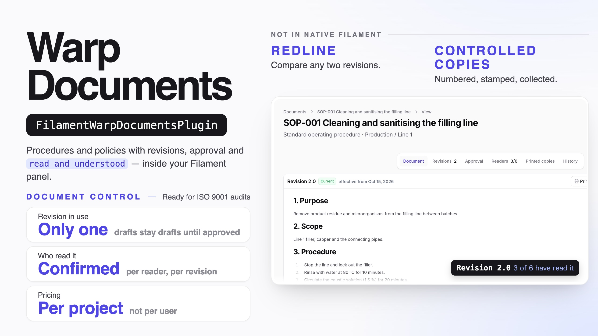
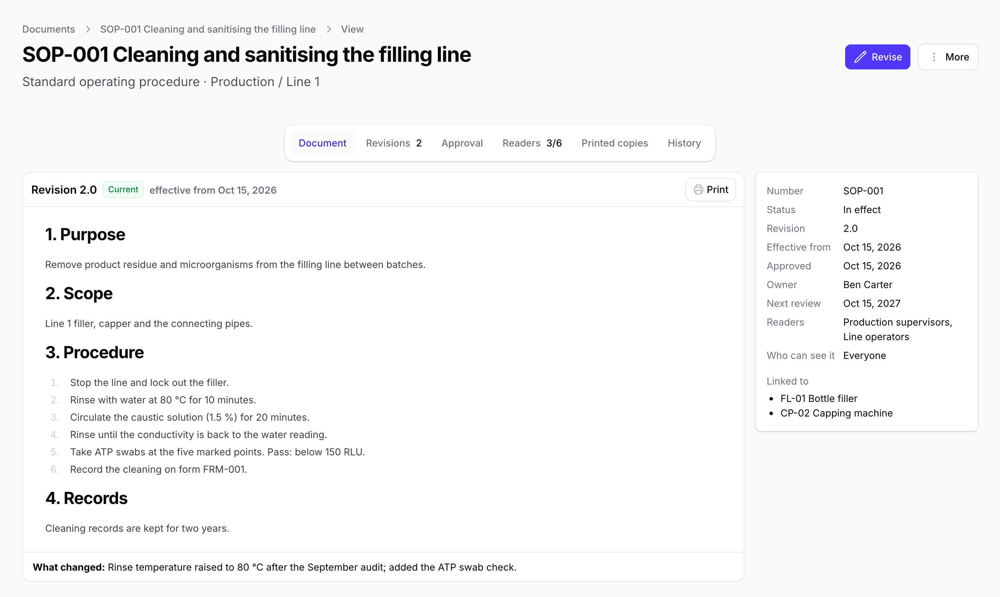
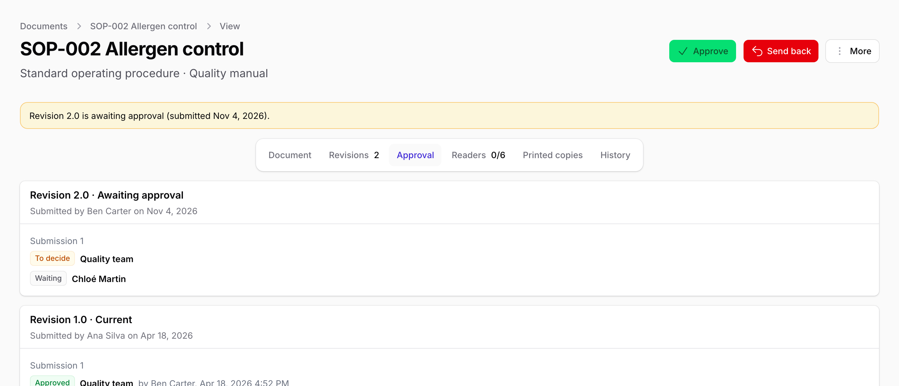
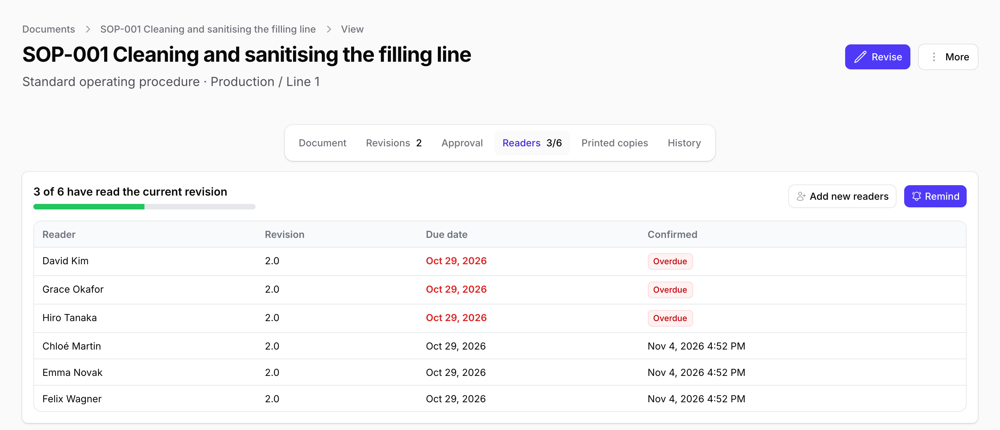
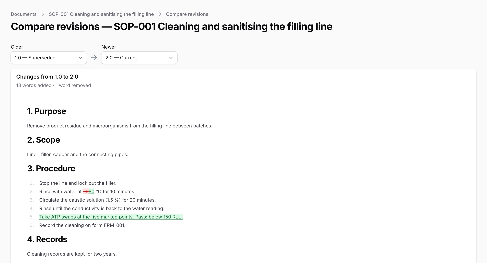

# Warp Documents

**Document control for Filament. Procedures, policies, work instructions, forms and certificates live in your panel with revisions, approval, effective dates and “I have read and understood” confirmations — so everyone works from the current revision, and you can show an ISO 9001 auditor who approved what, who read it, and where the old paper copies went.**

<a href="https://demo.warpui.com/documents"></a>

Revise a procedure, submit it, switch to the approvers to approve it, confirm reading it as a line operator, compare the revisions in red and print a numbered controlled copy — at **[demo.warpui.com/documents](https://demo.warpui.com/documents)**. No sign-up needed; the data is reset every hour.



- [What it does](#what-it-does)
- [Installation](#installation)
  - [AI coding assistants (Laravel Boost)](#ai-coding-assistants-laravel-boost)
- [Quick start](#quick-start)
- [Importing the documents you already have](#importing-the-documents-you-already-have)
- [Document types](#document-types)
- [Files and pages](#files-and-pages)
- [Showing Word and Excel files as PDF](#showing-word-and-excel-files-as-pdf)
- [Revising a document](#revising-a-document)
- [Approval](#approval)
- [Approval with Warp Flow](#approval-with-warp-flow)
- [Effective dates](#effective-dates)
- [Readers and “I have read and understood”](#readers-and-i-have-read-and-understood)
- [Reviews, expiry dates and reminders](#reviews-expiry-dates-and-reminders)
- [Making a document obsolete](#making-a-document-obsolete)
- [Comparing revisions](#comparing-revisions)
- [Controlled copies and watermarks](#controlled-copies-and-watermarks)
- [Finding documents by the words in their files](#finding-documents-by-the-words-in-their-files)
- [The master list](#the-master-list)
- [The read matrix](#the-read-matrix)
- [Linking documents to your records](#linking-documents-to-your-records)
- [My document tasks](#my-document-tasks)
- [Who can see and change what](#who-can-see-and-change-what)
- [Plugin options](#plugin-options)
- [Files and storage](#files-and-storage)
- [Audit trail](#audit-trail)
- [Events](#events)
- [Using it from code](#using-it-from-code)
- [Multi-tenancy](#multi-tenancy)
- [Requirements](#requirements)

## What it does

| | |
| --- | --- |
| **One current revision** | Everyone sees the approved, effective revision. A new revision is a draft that only its author and approvers see until it is approved — the current one stays in use meanwhile. |
| **Files or pages** | Upload PDF, Word, Excel, images or anything else, or write the document as a page in the panel. PDFs, images and pages open right in the panel; Word, Excel and PowerPoint files are turned into a PDF for reading automatically — this needs LibreOffice on your server or a Gotenberg service ([what to install](#showing-word-and-excel-files-as-pdf)) — or you add one by hand. |
| **Approval built in** | Approvers by person or group, one after another or all at once, with send back and resubmit. Nobody approves their own revision. Optional password signatures. |
| **…or through Warp Flow** | With [Warp Flow](https://warpui.com) installed, hand approval to a Flow route: the author’s manager, the department head, conditions, delegation. One setting. |
| **Read and understood** | Readers (everyone, groups or people) confirm each new revision. Minor corrections need no new confirmation. Progress, due dates, reminders — and, where it matters, a few questions that must be answered correctly first. |
| **Reviews and expiry** | A review date from the document type (“every 12 months”), expiry dates for certificates and licences, and a daily reminder command. |
| **Redline compare** | Pages show removed words struck through and added words underlined; files side by side with their details. |
| **Controlled copies** | “Print controlled copy” stamps the PDF with its copy number, holder, printer and date — optionally with a QR code that tells anyone holding the paper whether it is still current — and keeps a register. When a new revision takes effect, the old copies are listed for collection. Old revisions carry a SUPERSEDED or OBSOLETE watermark. |
| **Audit-ready** | Numbered documents, revision history, who approved and read what and when, an append-only history and a master list you can export to Excel or print. |
| **Read matrix** | People × documents on one sheet: who has read the current revision, who has not, who is overdue — with an Excel export. |
| **Bulk import** | Bring in the documents you already use from a register (Excel or CSV) and a ZIP, or drop the files: they keep their number, revision and effective date, and you see every row and its problems before anything is saved. |
| **Search inside files** | Find a document by a word that is only inside its Word, Excel, PowerPoint or PDF file — on any of the four databases, without a search server. |
| **Linked to your data** | Attach documents to your own records — the manual of a machine, the procedure of a process — and always show the current revision. |



## Installation

> **Warp Documents is a commercial plugin.** A license is required. After purchase you receive credentials for the private Composer repository.

Add the repository and authenticate:

```bash
composer config repositories.qalainau composer https://qalainau.privato.pub/composer
composer config --auth http-basic.qalainau.privato.pub "your-email" "your-license-key"
```

Install the package, run the migrations and publish Filament’s assets:

```bash
composer require qalainau/filament-warp-documents
php artisan migrate
php artisan filament:assets
```

The migration creates the `warp_documents_*` tables (folders, document types, documents, revisions, approval steps, read confirmations, links, controlled copies, history). Your tables are not changed. Deleting a document deletes its revisions, confirmations, links, copies and history with it; deleting a folder deletes its subfolders and leaves its documents without a folder; deleting a document type leaves its documents without a type. To edit the migration, publish it with `php artisan vendor:publish --tag=filament-warp-documents-migrations` before you run `php artisan migrate` for the first time: Warp Documents then runs your copy instead of its own.

> Run `php artisan filament:assets` again after every update of the package.

Warp Documents sends [Filament database notifications](https://filamentphp.com/docs/5.x/notifications/database-notifications) and emails. If the panel does not use database notifications yet, add `->databaseNotifications()` to it and create the `notifications` table (`php artisan make:notifications-table && php artisan migrate`).

### AI coding assistants (Laravel Boost)

Warp Documents ships instructions for AI coding assistants such as Claude Code, Cursor and Codex. If your app uses
[Laravel Boost](https://laravel.com/docs/boost), the assistant learns how to use Warp Documents from them: how to
register the plugin and link documents to records, use the lifecycle for revisions and approval, handle reading and
controlled copies, what is easy to get wrong, and how to test document control.

- **Guidelines** (`resources/boost/guidelines/core.md`): a short summary that Boost adds to `CLAUDE.md`,
  `AGENTS.md` and the other agent files. It also points the assistant to this README in `vendor/`, so it reads the
  documentation of the version you have installed instead of guessing.
- **Skill** `warp-documents-development` (`resources/boost/skills/`): the steps for linking records, revisions,
  built-in and Warp Flow approval, reading, controlled copies, imports, and feature tests. The assistant loads it when
  it works on document control.

Boost does not add guidelines of other vendors' packages on its own. When `php artisan boost:install` asks
"Which third-party AI guidelines/skills would you like to install?", select `qalainau/filament-warp-documents`. To do
it without the question, add the package to `boost.json` and run the command again:

```json
{
    "packages": ["qalainau/filament-warp-documents"]
}
```

```bash
php artisan boost:install --guidelines --skills -n
```

## Quick start

Add the plugin to a panel:

```php
use Qalainau\FilamentWarpDocuments\DocumentGroup;
use Qalainau\FilamentWarpDocuments\FilamentWarpDocumentsPlugin;

public function panel(Panel $panel): Panel
{
    return $panel
        // ...
        ->databaseNotifications()
        ->plugin(
            FilamentWarpDocumentsPlugin::make()
                ->groups([
                    DocumentGroup::make('quality')
                        ->label('Quality team')
                        ->users(fn () => User::where('department', 'quality')),
                    DocumentGroup::make('line')
                        ->label('Line operators')
                        ->users(fn () => User::where('role', 'operator')),
                ])
                ->canManageUsing(fn (User $user) => $user->department === 'quality')
        );
}
```

Schedule the daily reminders (in `routes/console.php`):

```php
use Illuminate\Support\Facades\Schedule;

Schedule::command('warp-documents:remind')->dailyAt('08:00');
```

Then, in the panel:

1. **Document types** — create “Standard operating procedure” with the number `SOP-{000}`, a review every 12 months, the approvers “Quality team” then the production manager, and the readers “Line operators”.
2. **Documents → New document** — upload a PDF (or write a page), choose the type: it gets the number SOP-001 and starts as a draft.
3. **Submit for approval** — the approvers find it under **My document tasks** and approve it.
4. Revision 1.0 is in effect. The line operators are asked to read it and confirm.

The navigation gets **My document tasks**, **Documents**, **Master list**, **Read matrix**, **Document types** and **Document folders** (in a “Documents” group). Add `DocumentTasksWidget` to the dashboard to show each person’s open tasks.

## Importing the documents you already have

A document system is only useful once the documents you already work with are in it. **Documents → Import documents** (document managers only) registers them in one go — as approved revisions with their own number, revision and effective date, without sending each one through approval.

There are two ways, and they can be combined:

1. **A register and a ZIP** — for documents that already have numbers and revisions. The register is an Excel (`.xlsx`) or CSV file with one document per row; its **File** column names a file in the ZIP (`SOP-001.pdf`, or with its folder: `Quality/SOP-001.pdf`). **Download the register template** gives you the columns.
2. **Just the files** — drop many files, or a whole folder. Without a register every file becomes one document named after the file. *File names start with the document number* turns `SOP-012 Cleaning the line.pdf` into number SOP-012, title “Cleaning the line”.

| Register column | |
| --- | --- |
| **Number** | The document number. Empty: the next number of the document type. Must not be used by another document. |
| **Title** | Empty: the file name. |
| **Revision** | `2.1`, `Rev 3` — or `B`, `A.1` for a type that numbers revisions with letters. Empty: the first revision. Format the column as text in Excel, so `2.10` does not become `2.1`. |
| **Effective from** | The day the revision took effect, written `2026-03-31` (also `31.03.2026`, `2026/3/31` or an Excel date cell). Dates like `03/04/2026` are refused, because day and month cannot be told apart. Empty: the date chosen on the page. |
| **File** | Required. The name of a file in the ZIP or among the dropped files. |
| **Type** | The name of a document type. It must exist. |
| **Folder** | `Quality / Procedures`. Missing folders are created. |
| **Owner** | A person’s email address or name, exactly. Empty: the owner chosen on the page. |
| **Description**, **Next review**, **Expires on** | Optional. Without **Next review**, the type’s review cycle is counted from the effective date. |

The column names can be written in any of the ten languages of the plugin, in any order; other columns are ignored and listed.

**Check the files** saves nothing. It shows every row with what will be created — number, revision, effective date, file, type, folder, owner — and, in red, what is wrong with a row: a file that is not in the ZIP, a number that is already taken, a type that does not exist, a date it cannot read. Files that are in the ZIP but not in the register are listed too. **Import N documents** then imports the rows without problems and leaves the others out; correct the register and check again to bring them in. If anything fails during the import, nothing is saved.

Imported documents are in effect from their effective date (a date in the future makes them “Effective soon”). Their history says who imported them. Readers are **not** asked to read them, because the documents are already in use — unless you turn on *Ask the readers to read the imported documents*. The next revision continues from the imported one: after `3.2`, **Revise** starts `4.0`.

### Limits and safety

```php
FilamentWarpDocumentsPlugin::make()->imports(
    maxFiles: 500,            // files in one import
    maxRows: 2000,            // rows in the register
    maxArchiveSize: 204800,   // the ZIP, in KB (200 MB)
    maxUnpackedSize: 1048576, // all files of the ZIP after unpacking, in KB (1 GB)
    extensions: ['pdf', 'docx', 'xlsx'],
)
```

| | |
| --- | --- |
| **File types** | Only files with an accepted extension are taken (by default PDF, Word, Excel, PowerPoint, OpenDocument, RTF, text, CSV, common images, DWG/DXF and Visio). Everything else — `.php`, `.html`, `.svg`, `.exe` … — is listed as “not imported”. If `uploads(types: [...])` limits MIME types, imported files must match them too. |
| **ZIP paths** | Names inside the ZIP are never used as paths on your disk: every file is stored under a random name in the document’s own folder. Entries whose names point outside the ZIP (`../`, absolute paths, drive letters) are refused. |
| **Size** | Each file may be as large as `uploads(maxSize:)`. The sizes are checked before unpacking and again while unpacking, so a ZIP that expands to more than it declares is stopped. Password-protected and empty entries are refused. |
| **Upload limits** | A large ZIP also has to pass PHP’s `upload_max_filesize` / `post_max_size` and Livewire’s `temporary_file_upload.rules` (12 MB by default). |
| **Who** | Only document managers (`canManageUsing()`) who may create documents; narrow it further with `canImportUsing(fn (User $user) => …)`. Turn the page off with `->imports(false)`. Note that without `canManageUsing()` everyone in the panel is a document manager. |
| **Tenancy** | Documents, folders, types and numbers of the import belong to the current tenant only. |

Folders dropped into the browser arrive as their files only; to keep the folder structure, put the folder in a ZIP and turn on *Make folders from the ZIP’s folders*.

### Importing from code

```php
use Qalainau\FilamentWarpDocuments\Domain\Lifecycle;
use Qalainau\FilamentWarpDocuments\Import\Importer;

// one document
Lifecycle::import([
    'title' => 'Allergen control',
    'number' => 'SOP-104',
    'type_id' => $type->id,
    'file' => $path,                 // a path on the plugin's disk
    'file_name' => 'allergen-control.pdf',
    'revision' => '3.2',
    'effective_on' => '2024-05-01',
    'request_reading' => false,      // true: ask the readers to confirm
], $manager);

// a register and a ZIP that are already on the plugin's disk
$importer = Importer::make([
    'register' => $registerPath, 'register_name' => 'register.xlsx',
    'archive' => $zipPath,
    'owner_id' => $manager->id, 'effective_on' => '2026-01-01',   // for rows that do not say
]);

$plan = $importer->plan();           // nothing is saved; $plan->rows[n]->errors, $plan->notes
$count = $importer->run($manager);   // imports the rows without problems
```

Both throw `DocumentsException` when the person is not a document manager.

## Document types

A document type holds the rules for its documents:

| Setting | What it does |
| --- | --- |
| **Document number** | `SOP-{000}` numbers documents SOP-001, SOP-002, … (`{00}` for two digits, `{0}` without padding). The next number can be changed. Leave it empty to type numbers by hand. Numbers are unique (per tenant). |
| **Revision numbers** | *Numbers*: 1.0, 1.1, 2.0. *Letters*: A, A.1, B — Z is followed by AA. |
| **Review every** | Months until the next review, counted from the day a revision takes effect or the document is reviewed. Empty: no regular review. |
| **Approvers** | People and groups, in order. For a group, any one member approves the step. |
| **Order** | *One after another* (the next approver is asked when the previous one approved) or *All at once* (everyone is asked together; the revision is approved when all have approved). |
| **The submitter can add approvers** | Lets the author add people or groups when submitting, after the type’s approvers. A type without approvers needs at least one added approver. |
| **Readers** | Everyone, groups or people who must read each new revision. A document can choose its own readers instead. |
| **Read again when** | *Major changes only* (default), *Every new revision*, or *Only the first revision*. |
| **Read within** | Days after the effective date for the due date of each confirmation. |
| **Template for pages** | New page documents of this type start with this text. |

Documents can also be created without a type: they then need an approver chosen when submitting, have no readers unless the document chooses them, and no review cycle.

## Files and pages

When creating a document, choose **Upload a file** or **Write a page**.

- **Files** keep their original name, type, size and SHA-256 checksum for every revision. PDFs and images (PNG, JPEG, GIF, WebP) open inside the panel. Other files — Word, Excel, CAD — are downloaded; when checking in such a file, add a **PDF for reading**, which is shown instead and used for controlled copies — or let the plugin [make it automatically](#showing-word-and-excel-files-as-pdf). HTML and SVG files are always downloaded, never opened, so they cannot run scripts in your app.
- **Pages** are written with Filament’s rich editor, including images. Pages can be printed (with the controlled-copy stamp) and compared word by word.

Change the editor with `->richEditor(fn (RichEditor $editor) => $editor->toolbarButtons([...]))`.

## Showing Word and Excel files as PDF

Most procedures are written in Word. A browser cannot show a `.docx`, so without help readers would have to download it — or the author would have to export a PDF by hand for every revision. With `convertToPdf()` the plugin does that itself: whenever a Word, Excel or PowerPoint file is stored, it makes a **PDF for reading** from it.

> **This feature needs a program outside PHP.** The plugin does not convert Office files itself. Before you turn it on, set up **one** of these:
>
> - **LibreOffice on the server that runs your app** (and on the queue worker, with `queue: true`):
>   `sudo apt-get install -y --no-install-recommends libreoffice-writer libreoffice-calc libreoffice-impress fonts-liberation` on Debian / Ubuntu, `brew install --cask libreoffice` on macOS. Check with `soffice --version`. Add the fonts your documents use (for Japanese, Chinese and Korean: `fonts-noto-cjk`).
> - **A [Gotenberg](https://gotenberg.dev) service** the app can reach over HTTP — nothing to install on the app server. Use this on hosts where you cannot install packages (shared hosting, Laravel Cloud, Vapor).
>
> Without either, nothing breaks, but nothing is converted: Word, Excel and PowerPoint files are offered as a download, as before.

```php
use Qalainau\FilamentWarpDocuments\Processing\Converters\GotenbergConverter;
use Qalainau\FilamentWarpDocuments\Processing\Converters\LibreOfficeConverter;

// LibreOffice installed on the server
FilamentWarpDocumentsPlugin::make()->convertToPdf(LibreOfficeConverter::make());

// or a Gotenberg container (https://gotenberg.dev) — nothing to install on the app server
FilamentWarpDocumentsPlugin::make()->convertToPdf(GotenbergConverter::make('http://gotenberg:3000'));

// or anything else that turns a file into a PDF
FilamentWarpDocumentsPlugin::make()->convertToPdf(
    fn (string $path, string $name): ?string => MyConverter::toPdf($path),   // return the PDF's bytes, or null
);
```

What changes for people:

- The document page shows the PDF right in the panel, marked “PDF made automatically from cleaning.docx”. **Download cleaning.docx** still gives the original file — the Word file stays the revision’s file, with its checksum.
- **Print controlled copy** and **Download with watermark** work for these documents too, because they stamp the PDF.
- Every revision gets its own PDF: uploading a new file with **Upload new file** makes a new one. A PDF uploaded by hand in **PDF for reading** is kept and nothing is converted.

| Argument | Default | |
| --- | --- | --- |
| the converter | `null` (off) | `LibreOfficeConverter::make(?string $binary = null, int $timeout = 120)` — finds `soffice` or `libreoffice` in the `PATH` and the usual install folders when no path is given (a web server’s `PATH` is often short, so give the path if yours is elsewhere). `GotenbergConverter::make(string $url, int $timeout = 120, array $headers = [])`. Or a closure, or your own class implementing `Processing\Converters\PdfConverter`. |
| `extensions:` | `doc`, `docx`, `xls`, `xlsx`, `ppt`, `pptx`, `odt`, `ods`, `odp`, `rtf` | Which files are converted. PDFs and images never are. |
| `queue:` | `false` | `true` converts in a queued job (`ProcessVersionFile`). A conversion takes a few seconds; without the queue, saving the upload waits for it. Until the job has run, the page offers the download as before. |

Things to know:

- **Nothing to convert with? Nothing changes.** Without `convertToPdf()`, or when the converter is not reachable, the file is stored as before and the page offers the download.
- A failed conversion never blocks an upload. The error goes to your log; `php artisan warp-documents:process-files` makes the missing PDFs later (also for files stored before you turned the option on).
- The PDF looks the way LibreOffice renders the file. Fonts that are not installed on the server (or in the Gotenberg image) are replaced, which can move line breaks — install the fonts your documents use.
- **Uploads are untrusted files.** LibreOffice is started without a shell, with an empty profile in a temporary folder, a time limit, and without the file’s original name. If people outside your organization can upload, prefer Gotenberg: the conversion then runs in its own container. The Gotenberg request carries only the file content, under a neutral name.
- The Gotenberg URL is the same service [Warp Print](https://warpui.com) uses for its PDFs.

A new file always drops the previous file’s PDF for reading — also without `convertToPdf()`. A revision never shows a PDF that was made from an older file.

## Revising a document

1. **Revise** (the owner or a document manager) starts a draft of the next revision from the current one. The document shows “Ben Carter is working on revision 2.0” to everyone; only one draft exists at a time and only its author can change it — or a document manager, who can take over when the author is away.
2. For files: **Upload new file** replaces the draft’s file (and optional PDF for reading). For pages: **Edit the page** opens the editor.
3. **Submit for approval** asks for **What changed** (required from the second revision on — readers and auditors see it) and whether it is a **Major change**:
   - major: the next whole number (2.0, or B) — readers must read it again;
   - minor: the next decimal (1.1, or A.1) — for small corrections, readers are not asked again (unless the type says *Every new revision*).
4. **Discard draft** deletes the draft revision and its new file; the current revision is untouched. A document that was never approved has no current revision, so instead it can be deleted with **Delete draft document**.

Approved revisions and their files never change.

## Approval



The approvers get a notification and find the revision under **My document tasks → To approve**; on the document page the revision to approve is shown instead of the current one.

- **Approve** (optional comment) moves to the next step, or approves the revision after the last one.
- **Send back** (a reason is required) returns the revision to its author as a draft. The author changes it and submits it again; approval starts again from the first step. Every submission is kept on the **Approval** tab.
- **Withdraw from approval** (the owner or a manager) turns it back into a draft.
- The person who submits a revision cannot approve it, even as a member of an approving group. A submission is refused when an approver is the submitter, or a group has no other member.

### Password signatures

```php
FilamentWarpDocumentsPlugin::make()->signatures()
```

Approving and confirming reading then ask for the person’s password, and the history records the step as signed. This supports the electronic-signature practices of regulated industries; whether it meets a specific regulation (such as 21 CFR Part 11) depends on your whole system and procedures.

## Approval with Warp Flow

When an approval route depends on your organization — the author’s manager, the head of the department, a director above some condition — let [Warp Flow](https://warpui.com) approve revisions instead:

```php
use Qalainau\FilamentWarpDocuments\FilamentWarpDocumentsPlugin;
use Qalainau\FilamentWarpDocuments\Integrations\Flow\ApprovableVersion;
use Qalainau\FilamentWarpFlow\FilamentWarpFlowPlugin;

$panel->plugins([
    FilamentWarpFlowPlugin::make()->models([ApprovableVersion::class]),
    FilamentWarpDocumentsPlugin::make()->flowApprovals('documents'),
]);
```

In Warp Flow, create a flow with the key `documents` for **ApprovableVersion**. Its conditions can use the document type, the folder, *Major change* and the owner. Then:

- **Submit to Warp Flow** submits the revision as a Flow request; approvers work in Warp Flow (inbox, thread, delegation, email approval) and the document page links to the request.
- When the flow approves it, the revision takes effect exactly as with built-in approval (readers, review date, notifications).
- Returned to the applicant → the revision is a draft again; submitting it again resubmits the same Flow request. Rejected → the revision is withdrawn and the document can be revised again. Withdrawn in either place → a draft again.

Warp Documents works without Warp Flow; nothing of Warp Flow is loaded unless `flowApprovals()` is set. The approver settings of document types are hidden in that panel.

## Effective dates

When submitting, **Effective from** can be left empty (the revision takes effect when it is approved) or set to a later date — for example to give people time to train. Until then, the document keeps its current revision and shows “Revision 2.0 is approved and takes effect on …”. The switch happens by date; no scheduled job is needed.

## Readers and “I have read and understood”



When a revision is approved and needs reading, every reader gets a confirmation to do (due after **Read within** days). Readers see a banner on the document and the task under **My document tasks → To read**, and confirm with **I have read and understood** (with their password when signatures are on).

The **Readers** tab shows who has read the current revision and who has not, with overdue ones in red. **Remind** notifies those who have not read it; **Add new readers** asks people who joined a reader group since the revision was approved. When a newer revision takes effect, unread confirmations of the older one are cancelled — people read the new one instead.

### A comprehension check before confirming

“I have read and understood” is easy to click. For documents where you have to *know* that people understood — in regulated industries, for safety instructions — add a few questions:

**Edit details → Comprehension check → Add a question**: the question, the correct answer and one to five wrong answers. **Correct answers needed** sets the pass mark (empty: all of them). Up to 20 questions.

For readers, **I have read and understood** then shows the questions with the statement:

- Enough answers right: the confirmation is recorded, with the result (3/3) and the number of tries.
- Not enough: nothing is confirmed, the dialog stays open and says how many were right — “You answered 2 of 3 questions correctly and need 3. Read the document again and answer once more.” It does not say which ones. Readers can answer as often as they need; every failed try is counted and written to the history.

The **Readers** tab shows it per person: “check 3/3, 2 tries”, or “check not passed (1 try)” for someone who has not made it yet.

Things to know:

- The answers are shown in an order that differs per reader, and the browser only ever receives the answer texts — which one is correct stays on the server and is checked there.
- The questions belong to the document, not to one revision: the next revision asks them again (when readers must read it again). Change them on **Edit details** when the content changes; confirmations that were already given stay as they are.
- Only the owner and document managers can see and edit the questions. Documents without questions work exactly as before.
- With `signatures()`, the password is asked together with the questions.
- From code, pass the chosen answer texts: `Lifecycle::acknowledge($acknowledgement, user: $reader, answers: ['80 °C', 'The shift supervisor'])`. Wrong or missing answers throw a `DocumentsException` and count as a try.

## Reviews, expiry dates and reminders

- **Next review** is set from the type’s review cycle. The owner can record **Reviewed, no changes** (with a comment), which sets the next date, or revise the document.
- **Expires on** (certificates, licences, contracts) is set on the document; after that date its status is *Expired*.
- `php artisan warp-documents:remind` (daily) reminds approvers and readers who have waited `reminders(everyDays:)` days (default 3), and tells owners about reviews and expiry dates `reviewDays` / `expiryDays` days ahead (default 30). Each reminder is repeated at most every `everyDays`.

```php
FilamentWarpDocumentsPlugin::make()->reminders(reviewDays: 45, expiryDays: 60, everyDays: 7)
```

## Making a document obsolete

**Make obsolete** (a reason is required) withdraws a document from use: an open draft or submission is withdrawn, outstanding confirmations are cancelled, it disappears from the documents list (filter *Status: Obsolete* to find it) and the master list, its revisions carry an OBSOLETE watermark, and the owner is told how many printed copies to collect. Its history stays.

## Comparing revisions



**More → Compare revisions** (or **Compare** on the Revisions tab) compares any two revisions. Pages show the newer revision with removed words struck through in red and added words underlined in green, and the number of words added and removed. Files are shown side by side with their file name, size, checksum, change summary and effective date.

## Controlled copies and watermarks

**More → Print controlled copy** registers a numbered paper copy (and where it goes, e.g. “Line 2 workstation”) and downloads the current revision as a PDF with a stamp on every page:

> CONTROLLED COPY No. 7 — SOP-004 Cleaning the filling line, revision 2.0 · Given to: Line 2 workstation
> Printed by Ana Silva on 2026-11-05. Check that this is the current revision before use.

The stamp is added in the browser with [pdf-lib](https://pdf-lib.js.org) (no Chrome or other software on the server), as an image so names in any language print correctly. Pages open a printable view with the same stamp. The **Printed copies** tab is the register: when a newer revision takes effect, older copies show **Collect**, and **Mark as collected** records who collected them. **My document tasks → Copies to collect** lists them for the owner.

### A QR code that tells whether the paper is still current

```php
FilamentWarpDocumentsPlugin::make()->copyCheck()
```

A paper copy cannot update itself — but with `copyCheck()` its stamp carries a QR code, and anyone holding the paper can scan it with a phone:

| The page says | When |
| --- | --- |
| **This copy is current** (green) | The copy’s revision is the one in effect. |
| **Do not use this copy** — a newer revision (3.0) is in effect (red) | A newer revision took effect after the copy was printed. |
| **Do not use this copy** — collected on … (red) | The copy was marked as collected. |
| **Do not use this copy** — the document is obsolete (red) | The document was made obsolete. |

The answer is computed when the code is scanned, so a copy printed last year turns red the day a new revision takes effect. On the **Printed copies** tab, **QR page** opens the same page for each copy.

What the page shows, and what it does not — it has to work for someone on the shop floor who is not logged in, so it is deliberately small:

- **Shown:** the status, and what is printed on the paper anyway: the document number, the copy number and the copy’s revision. When superseded, the number of the revision now in effect.
- **Not shown:** the content, the file, any link into the panel, the title, the owner, who printed the copy and where it was given. Add the title with `->copyCheck(showTitle: true)` if your titles are not confidential.
- **The address** is `…/warp-documents/copy/<token>` with a random 40-character token per copy. It cannot be derived from the document or copy number, and every wrong address gets the same “not found”. The token is not a signed URL with an expiry date on purpose: paper lives for years and would outlive any expiry — the copy’s own status (collected, superseded) is what ends its validity.
- The page is limited to 60 requests a minute per visitor, is not indexed by search engines and is never cached.
- Without `copyCheck()` there is no public page and no QR code: stamps look as before.

The QR code is drawn in the browser (the [qrcode-generator](https://github.com/kazuhikoarase/qrcode-generator) library is bundled); nothing is sent to another service. The page speaks the app’s language (`app.locale`), because the person scanning is not logged in.

Revisions that are not current — drafts, superseded, obsolete — show a watermark in the panel, and **Download with watermark** saves the PDF with the watermark and an “uncontrolled copy” stamp.

## Finding documents by the words in their files

The search box of the documents list looks at the number, the title, the description, the file name and the text of pages. With `fullTextSearch()` it also finds a document by a word that is only **inside its file**:

```php
FilamentWarpDocumentsPlugin::make()->fullTextSearch(pdftotext: true)
```

> **Searching inside PDFs needs `pdftotext` on the server.** Word, Excel, PowerPoint and OpenDocument files are read by the plugin itself, with nothing to install. PDFs are read by the `pdftotext` program: `sudo apt-get install -y poppler-utils` on Debian / Ubuntu, `brew install poppler` on macOS; check with `pdftotext -v`. Without it, PDFs are not found by their content (by title, number and file name they still are). If you install it later, run `php artisan warp-documents:process-files --force` once.

When a file is stored (new document, **Upload new file**, import), its text is read once and kept with the revision. A document found through its text shows the words around the hit under its title — “In the text: …pass the ferrous test piece through the detector…”.

| File | How it is read |
| --- | --- |
| Word `.docx`, Excel `.xlsx`, PowerPoint `.pptx`, OpenDocument `.odt` `.ods` `.odp` | By the plugin itself, in PHP (the `zip` extension). Nothing to install. |
| `.txt`, `.csv`, `.md`, `.rtf` | By the plugin itself. |
| PDF | With `pdftotext` from [poppler-utils](https://poppler.freedesktop.org) (`apt install poppler-utils`, `brew install poppler`). `pdftotext: true` finds it in the `PATH` and in `/usr/bin`, `/usr/local/bin` and `/opt/homebrew/bin` (a web server’s `PATH` is often short); or give the path: `pdftotext: '/usr/bin/pdftotext'`. Without it, PDFs are simply not read — everything else works. |
| Scans, images, old `.doc` / `.xls`, anything else | Not read, unless you plug in your own reader (below). |

| Argument | Default | |
| --- | --- | --- |
| `pdftotext:` | `null` | `true`, or the path of the binary. |
| `using:` | `null` | Your own reader: `fn (string $path, string $name, ?string $mime): ?string`. Called first for every file with a local copy of it; return the text, or `null` to let the plugin read it. Use it for OCR or a text-extraction service. |
| `queue:` | `false` | `true` reads the text in a queued job (`ProcessVersionFile`) instead of during the upload — for large files. |
| `maxLength:` | `200000` | Characters kept per file. |

Things to know:

- **Existing files** are not read when you turn the option on. Run `php artisan warp-documents:process-files` once (add `--force` to read everything again, for example after installing `pdftotext`).
- **Who finds what** does not change: the search covers only the **current** revision of documents the person may see. A draft’s text is not searched, and a restricted document is not found by people who cannot open it.
- The search is a plain `LIKE` on the stored text (case-insensitive, `ILIKE` on PostgreSQL), so it works the same on SQLite, MySQL, MariaDB and PostgreSQL and needs no full-text index. It matches the words as typed — no stemming, no ranking. For libraries of tens of thousands of long documents, add your own index on `warp_documents_versions.file_text`.
- A file that cannot be read (damaged, password-protected, a reader that fails) never blocks the upload; it is just not found by its content, and the error goes to your log.
- `pdftotext` is started without a shell, on a temporary copy of the file, with a 30-second limit.
- Without `fullTextSearch()` no file is opened and the search works as before.

## The master list

**Master list** lists the documents in effect with their number, title, type, folder, current revision, effective date, owner, next review and how many readers have read them. Turn off *Only documents in effect* to include drafts and obsolete documents. **CSV**, **Excel** and **Print** export what the table shows (filters and sorting included).

## The read matrix

**Read matrix** answers the auditor’s question “who has read what?” on one sheet: people down the side, the documents in effect across the top, and in each cell whether that person has confirmed the **current** revision.

| Cell | Meaning |
| --- | --- |
| Green, with a date | Read and confirmed on that date. |
| Amber, “Due …” | Asked, not read yet. |
| Red, “Overdue since …” | Not read, and the due date has passed. |
| — | That person is not a reader of the document. |

The last column counts each person’s confirmations (3 / 4), the last row each document’s. Filter the columns by **Type** and **Folder** and the rows by group (**People in**); **Only people who still have to read** hides everyone who is done. A document’s name opens its **Readers** tab, where you can remind the people who have not read it.

**CSV** and **Excel** export the matrix as it is filtered (the Excel file keeps the colours, with dates as `2026-11-05`). The screen shows up to 40 documents and 300 people; the exports hold everything.

Document managers see every document; other people see the page only if they own documents, and then only those. A reader of a document cannot open it. Documents count only while they are in effect: drafts, obsolete and expired documents are left out, and when a new revision takes effect the matrix switches to it.

From code:

```php
use Qalainau\FilamentWarpDocuments\Domain\ReadMatrix;

$matrix = ReadMatrix::build(['type_id' => $type->id, 'group' => 'line', 'outstanding' => true]);

foreach ($matrix->people as $userKey => $name) {
    foreach ($matrix->documents as $document) {
        $cell = $matrix->cell($userKey, $document->id);   // null, or ['state' => 'read'|'pending'|'overdue', 'date' => ?Carbon, 'due' => ?Carbon]
    }
}
```

Decide yourself who opens the page with `->canViewReadMatrixUsing(fn (User $user) => …)` (which documents a person sees in it does not change), or hide it with `->pages(readMatrix: false)`. Note that without `canManageUsing()` everyone in the panel is a document manager.

## Linking documents to your records

Link documents to your own models — the manual of a machine, the procedure of a process, the certificate of a supplier:

```php
use Qalainau\FilamentWarpDocuments\Concerns\HasDocuments;

class Machine extends Model
{
    use HasDocuments;

    // optional: the name shown on the document page
    public function documentLinkLabel(): string
    {
        return "{$this->code} {$this->name}";
    }
}

$machine->documents()->attach($document);
```

Show them on the record’s resource with the relation manager (link, unlink, open the current revision):

```php
use Qalainau\FilamentWarpDocuments\RelationManagers\DocumentsRelationManager;

public static function getRelations(): array
{
    return [DocumentsRelationManager::class];
}
```

or in an infolist:

```php
use Qalainau\FilamentWarpDocuments\Schemas\RelatedDocuments;

RelatedDocuments::make('documents')->label('Documents')
```

Both show only documents the person may see, always with their current revision. The document page lists the records it is linked to.

## My document tasks

**My document tasks** collects what the person has to do: revisions *To approve*, revisions *To read*, *My drafts*, *Reviews due* and *Expiring* documents they own, and printed *Copies to collect*. The menu shows the number of approvals and readings. `Qalainau\FilamentWarpDocuments\Widgets\DocumentTasksWidget` shows the same counts on the dashboard.

## Who can see and change what

| Who | Can |
| --- | --- |
| **Document managers** (`canManageUsing()`; everyone when not set) | Manage document types and folders, see every document and draft, change and submit anyone’s draft, and do everything an owner can. |
| **The owner** of a document | Revise, submit, withdraw, discard the draft, review, make obsolete, edit the details, remind readers, collect copies. |
| **The author** of a draft | Change it and submit it. Nobody else can, except document managers — not even the owner. |
| **Approvers** | See the revision they are asked to approve, approve or send it back. |
| **Readers** and everyone else | See documents shown to *Everyone*, and only their current, scheduled or older approved revisions — never drafts. |

A document’s **Who can see it** can be *Only the owner, readers and approvers*: it is then hidden from everyone else in lists, searches, the master list, linked records and file downloads. Who may create documents: `canCreateUsing(fn (User $user) => ...)`.

### Restricting pages per role

When your app has its own roles — some people may not use a screen at all, others may only look — decide it per page with the plugin:

```php
use Qalainau\FilamentWarpDocuments\FilamentWarpDocumentsPlugin;
use Qalainau\FilamentWarpDocuments\Pages\ReadMatrixPage;

FilamentWarpDocumentsPlugin::make()
    ->canAccessUsing(fn (User $user, string $page): bool => $user->canOpen($page))
    ->canWriteUsing(fn (User $user, string $page): bool => ! $user->isReadOnlyOn($page))
```

`$page` is one of these classes:

- `Qalainau\FilamentWarpDocuments\Pages\MyDocumentWork` — *My document tasks*.
- `Qalainau\FilamentWarpDocuments\Pages\MasterList` — the master list.
- `Qalainau\FilamentWarpDocuments\Pages\ReadMatrixPage` — the read matrix.
- `Qalainau\FilamentWarpDocuments\Widgets\DocumentTasksWidget` — the dashboard widget.

What they do:

- **`canAccessUsing()` false:** the page leaves the menu, its URL answers 403, and every Livewire call to a page that is already open answers 403 too. For the widget, it is not shown. When *My document tasks* is closed, the widget's numbers are no longer links to it.
- **`canWriteUsing()` false:** nothing changes on these three pages — they only show and download (tabs, filters, CSV, Excel, print), and all of that stays. It is there so the same callback can be passed to every Warp plugin.

Both are added to the existing rules with *and*: `canViewReadMatrixUsing()` and “document managers or owners” still decide who opens the read matrix, and these callbacks can't let more people in. People who are not signed in get `false`. Without the callbacks, nothing changes.

Documents, types and folders are resources: who may open, create, change and approve them is decided by your policies and by `canManageUsing()`, `canCreateUsing()` and `canImportUsing()` as described above — including the pages inside the document resource (*Compare revisions*, *Edit content* and *Import documents*).


**Your own policies count too.** When your app has a policy for a model of this plugin, document types and folders (`viewAny`), creating a document (`create`), opening it and its files, renditions and print view (`view`), editing it (`update`), and listing it in `RelatedDocuments` and in the *Documents* relation manager (its rows and the documents you can link, `view`) also asks it, together with the plugin's own options — so a role that may not use the screen gets a 403 there too. Without a policy nothing changes (also with Filament's `strictAuthorization()`).

### Groups

```php
DocumentGroup::make('quality')
    ->label('Quality team')
    ->users(fn () => User::where('department', 'quality'))   // a query, a relation or a collection of users
```

With [spatie/laravel-permission](https://spatie.be/docs/laravel-permission), `->rolesAsGroups()` also offers every role as a group.

## Plugin options

| Option | Default | Description |
| --- | --- | --- |
| `groups([...])` | none | Groups of people to choose as approvers and readers. |
| `rolesAsGroups()` | off | Offer spatie/laravel-permission roles as groups. |
| `canManageUsing(fn (User $user) => …)` | everyone | Document managers. |
| `canCreateUsing(fn (User $user) => …)` | everyone | Who can create documents. |
| `canImportUsing(fn (User $user) => …)` | document managers who can create | Narrows who may open **Import documents** (they must still be a document manager who can create documents). |
| `canViewReadMatrixUsing(fn (User $user) => …)` | document managers, and owners for their own documents | Who may open the **Read matrix**. When set, only this decides. |
| `convertToPdf($converter, extensions:, queue:)` | off | Make a PDF for reading from Word, Excel and PowerPoint files. Needs LibreOffice on the server or a Gotenberg service. See [showing Word and Excel files as PDF](#showing-word-and-excel-files-as-pdf). |
| `fullTextSearch(pdftotext:, using:, queue:, maxLength:)` | off | Find documents by the words inside their files. PDFs need `pdftotext` on the server. See [full-text search](#finding-documents-by-the-words-in-their-files). |
| `copyCheck(showTitle: false)` | off | A QR code on controlled copies that tells whether the paper is still current. See [controlled copies](#a-qr-code-that-tells-whether-the-paper-is-still-current). |
| `signatures(requirePassword: true)` | off | Ask for the password when approving and confirming reading. |
| `flowApprovals('documents')` | off | Approve revisions with the Warp Flow flow of this key. |
| `disk('local', 'warp-documents')` | `local`, `warp-documents` | Where files are stored. Keep it a private disk. |
| `uploads(maxSize: 51200, types: [...])` | 50 MB, any type | Upload limit in KB and allowed MIME types. |
| `userModel(User::class)` | the auth user model | The model of people. |
| `users(searchColumns: ['name', 'email'], label: fn (User $user) => …)` | name, email | How people are searched and named. |
| `scopeUsersUsing(fn (Builder $query, ?Model $tenant, ?string $tenantKey) => …)` | all users | Limit the people that can be chosen (and “Everyone”), e.g. to the current team. |
| `notifications(['database', 'mail'])` | both | Notification channels. `[]` sends none. |
| `reminders(reviewDays:, expiryDays:, everyDays:)` | 30, 30, 3 | See [reminders](#reviews-expiry-dates-and-reminders). |
| `pages(myWork:, masterList:, types:, folders:, readMatrix:)` | all on | Which pages and resources to add. |
| `imports(enabled:, maxFiles:, maxRows:, maxArchiveSize:, maxUnpackedSize:, extensions:)` | on, 500, 2000, 200 MB, 1 GB | See [importing](#limits-and-safety). |
| `navigationGroup('Quality')` | “Documents” | Navigation group; `null` for none. Also takes a closure — see [translated labels](#translated-labels). |
| `richEditor(fn (RichEditor $editor) => …)` | — | Customize the editor of pages. |
| `tenantKeyUsing(fn () => …)` | Filament tenant | See [multi-tenancy](#multi-tenancy). |

### Translated labels

If your app sets the language per user (`App::setLocale()` in a middleware), pass a **closure** instead of a string for the navigation group and for group labels. The panel is configured before the user's language is known, so `->navigationGroup(__('Quality'))` would always show the first language. A closure is called each time the menu or the label is shown, in the current language:

```php
FilamentWarpDocumentsPlugin::make()
    ->navigationGroup(fn () => __('Quality'))
    ->groups([
        DocumentGroup::make('quality')
            ->label(fn () => __('Quality team'))
            ->users(fn () => User::where('department', 'quality')),
    ])
```

Use the same text as the `NavigationGroup::make(fn () => __('Quality'))` of your own resources, so the plugin's pages join the same group in every language. A closure that returns `null` puts the pages in the default “Documents” group.

## Files and storage

Files are stored on the plugin’s disk (`local` by default) under `warp-documents/<document id>/`. They are never public: every download goes through the panel and checks who may see the revision. Files are never overwritten — a new revision gets a new file — and a draft’s file is deleted only when the draft is discarded and no other revision uses it. Images in pages are stored privately on the same disk and shown with temporary URLs (the `local` disk needs `'serve' => true`, Laravel’s default).

## Audit trail

The **History** tab lists everything that happened to a document — created, revised, submitted, each approval step with its comment and signature, sent back, approved and effective date, read and understood, reviewed, copies printed and collected, details changed, downloads, made obsolete — with the person and time. History entries cannot be changed or deleted.

## Events

| Event | When |
| --- | --- |
| `VersionSubmitted` | A revision is submitted for built-in approval. |
| `VersionApproved` | The last approval is done (built in or Warp Flow). `$event->version->effective_on` is the effective date. |
| `VersionReturned` | A revision is sent back (`$event->comment`). |

```php
use Qalainau\FilamentWarpDocuments\Events\VersionApproved;

Event::listen(VersionApproved::class, function (VersionApproved $event) {
    Training::scheduleFor($event->version->document);
});
```

## Using it from code

`Qalainau\FilamentWarpDocuments\Domain\Lifecycle` performs every step the panel does, with the same checks:

```php
use Qalainau\FilamentWarpDocuments\Domain\Lifecycle;

$document = Lifecycle::create([
    'title' => 'Allergen control',
    'type_id' => $type->id,
    'kind' => 'file',
    'file' => $path,               // a path on the plugin's disk
    'file_name' => 'allergen-control.pdf',
], $author);

Lifecycle::submit($document->openVersion, extraApprovers: ['user:'.$qa->id], effectiveOn: '2026-12-01', user: $author);
Lifecycle::approve($document->openVersion->currentSteps()->first(), comment: 'OK', user: $qa);

$draft = Lifecycle::checkOut($document, $author);
Lifecycle::saveDraft($draft, ['file' => $newPath, 'file_name' => 'v2.pdf', 'change_summary' => 'Sesame added', 'is_major' => true], $author);
```

Each method throws `Qalainau\FilamentWarpDocuments\DocumentsException` with a message written for people when the step is not allowed. `$document->currentVersion`, `->openVersion` and `->scheduledVersion` give the current, draft/submitted and approved-but-not-yet-effective revisions.

## Multi-tenancy

Warp Documents works with [Filament’s multi-tenancy](https://filamentphp.com/docs/5.x/users/tenancy): each tenant has its own folders, document types, numbers and documents, and files are only served within their tenant. Limit the people that can be chosen to the tenant’s members:

```php
FilamentWarpDocumentsPlugin::make()
    ->scopeUsersUsing(fn (Builder $query, ?Model $tenant) => $query->whereRelation('teams', 'teams.id', $tenant?->getKey()))
```

Panels without Filament tenancy can still separate companies with `->tenantKeyUsing(fn () => auth()->user()->company_id)`. The reminder command runs for every tenant and links to each tenant’s panel.

## Requirements

- PHP 8.3+
- Laravel 12 or 13
- Filament 5.8.3 or later
- SQLite, MySQL 8.0+, MariaDB 10.11+ or PostgreSQL 14+
- The PHP `zip` extension (Excel export, import, reading Office files)
- For two features, a program outside PHP (everything else works without them):
  - [Showing Word and Excel files as PDF](#showing-word-and-excel-files-as-pdf): LibreOffice on the server, or a Gotenberg service
  - [Searching inside PDFs](#finding-documents-by-the-words-in-their-files): `pdftotext` (poppler-utils) on the server

The interface is translated into English, Japanese, German, French, Spanish, Italian, Brazilian Portuguese, Korean and Chinese (simplified and traditional). Each follows the app’s locale (`App::setLocale()`). Dates follow the app’s locale, and times the panel’s display timezone. Effective, due, review and expiry dates are calendar days in the app’s timezone.

## Support

Questions before or after buying: [warpui.com/support](https://warpui.com/support?plugin=documents).

## License

Warp Documents is a commercial plugin. See [LICENSE.md](LICENSE.md).
